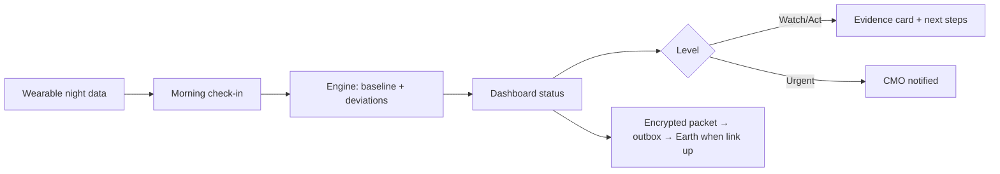

# VITALS-M: offline astronaut health self-monitoring

> NASA Space Apps Challenge entry. **Not a medical device.** No feature is clinically validated, and all demo data is synthetic.

## Challenge

Long-duration missions expose crews to radiation, altered gravity, isolation and a closed environment, which can cause immune changes, bone loss, cardiovascular changes and behavioural health problems. On long missions, astronauts carry much of the responsibility for noticing these changes themselves.
**Task:** build health monitoring software that gathers health indicators and lets astronauts evaluate and act on their health status.

## Problem

On a Mars transit, Earth is minutes away by signal and sometimes out of contact. Astronauts need a tool that tells them, without a ground team, **whether a change in their body or mind is real, how much it matters, and what to do next.**

## Our solution

An offline-first tablet app that learns **each astronaut's own normal** and flags sustained, explainable deviations from it:

- Nightly wearable data (sleep, resting HR, HRV, temperature) plus a 3-minute morning check-in (mood, symptoms, reaction-time test).
- Transparent statistics (robust personal baseline, EWMA, CUSUM, rules), not a black-box risk score.
- Five status levels (Calibrating / Within range / Watch / Act / Urgent), always shown as icon + word + colour.
- A "Why?" evidence card behind every alert, plus next steps: self-care → crew medical officer → flight surgeon.
- Works in a comms blackout. Earth packets are encrypted and wait in a queue until the link returns.
- The astronaut owns the data. The crew medical officer sees details only with consent, except at Urgent.

## Core features

See `requirements.md` §1 (MoSCoW). Highlights: personal baselines, deviation engine, check-in with reaction-time test, evidence cards, CMO crew grid, comms simulator with encrypted outbox, demo mission time-scrubber.

## Workflow



## Technology stack

React 18 · TypeScript · Vite · vite-plugin-pwa · Dexie (IndexedDB) · Recharts · Tailwind CSS · Web Crypto · Vitest · Playwright. Reasons in `requirements.md` §3.

## Repository structure (planned)

```
README.md  context.md  requirements.md  architecture.md  design.md  research.md
src/types.ts  src/engine/  src/services/  src/ui/
scripts/generate.ts   public/demo/mission.json   tests/
```

## Setup and running

> ⚠️ **Placeholder:** the app is not scaffolded yet. These are the *intended* commands for a Vite + npm project. Confirm them once the scaffold exists.

```bash
# prerequisites: Node.js LTS (version TBD at scaffold time)
npm install
npm run generate     # build public/demo/mission.json (planned script)
npm run dev          # local dev server
npm run build && npm run preview
```

## Testing

```bash
npm test             # Vitest: engine unit + scenario + wording-lint tests (planned)
npm run e2e          # Playwright smoke + offline test (planned)
```

## Demo walkthrough (about 3 min)

1. **Load demo mission:** 4 synthetic crew, 180 days of Mars transit.
2. **Control crew member (S4):** months of data, stays within range → "it doesn't cry wolf".
3. **S1 sleep restriction:** scrub forward, Sleep goes Watch → reaction time slows → Act. Open the evidence card.
4. **S2 illness-like pattern:** resting HR ↑, HRV ↓, temperature ↑ → Act. Do the check-in with a red-flag symptom → **Urgent**, and the CMO grid lights up.
5. **Comms blackout:** toggle Blackout and switch the network off. Everything still works and packets queue. Switch back to Online and they deliver after the delay.
6. **S3 isolation drift:** exercise and activity decline plus mood decline over weeks, shown on the mission timeline.
7. Close on honesty: source badges, "not a diagnosis", evidence in research.md.

## Limitations

- Synthetic and terrestrial data only; no validation on astronauts. Parameters are design hypotheses.
- Bone, immune and radiation are proxies or manual logs.
- Research citations were seen via search excerpts and must be re-verified (`research.md` §0).
- Demo-grade security: PIN, no encryption at rest, pre-shared export key.
- Alert text and symptom lists need physician review.

## Future work

Onboard health server with multi-device sync, real wearable/BLE ingestion, DTN-style Earth link, licensed validated questionnaires, physician-reviewed protocols, on-device LLM summaries, validation in analogue missions (e.g. HERA).

## Docs

`context.md` (start here) · `requirements.md` (scope, stack, roadmap, risks) · `architecture.md` · `design.md` · `research.md` (evidence).
