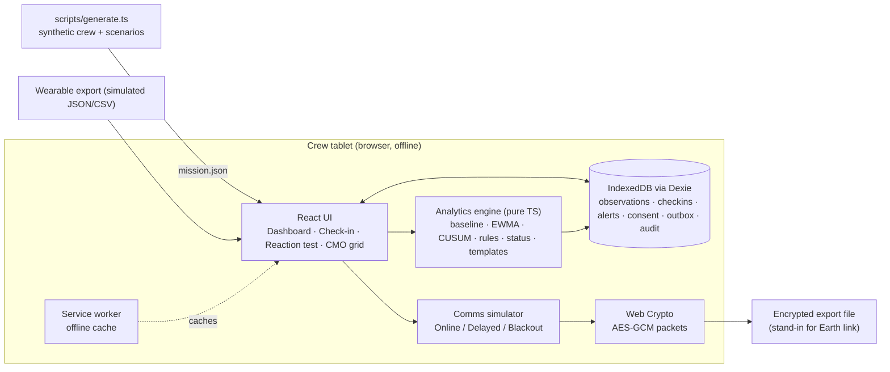
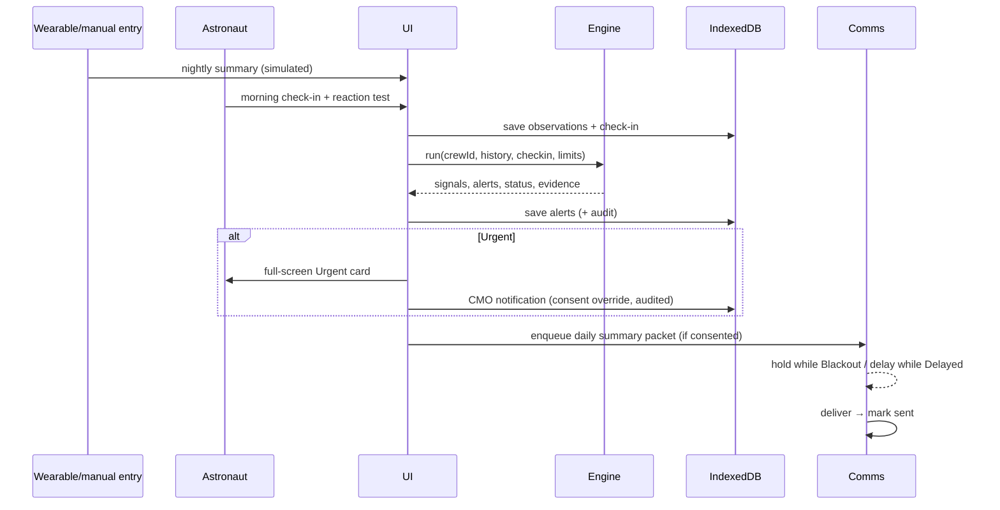
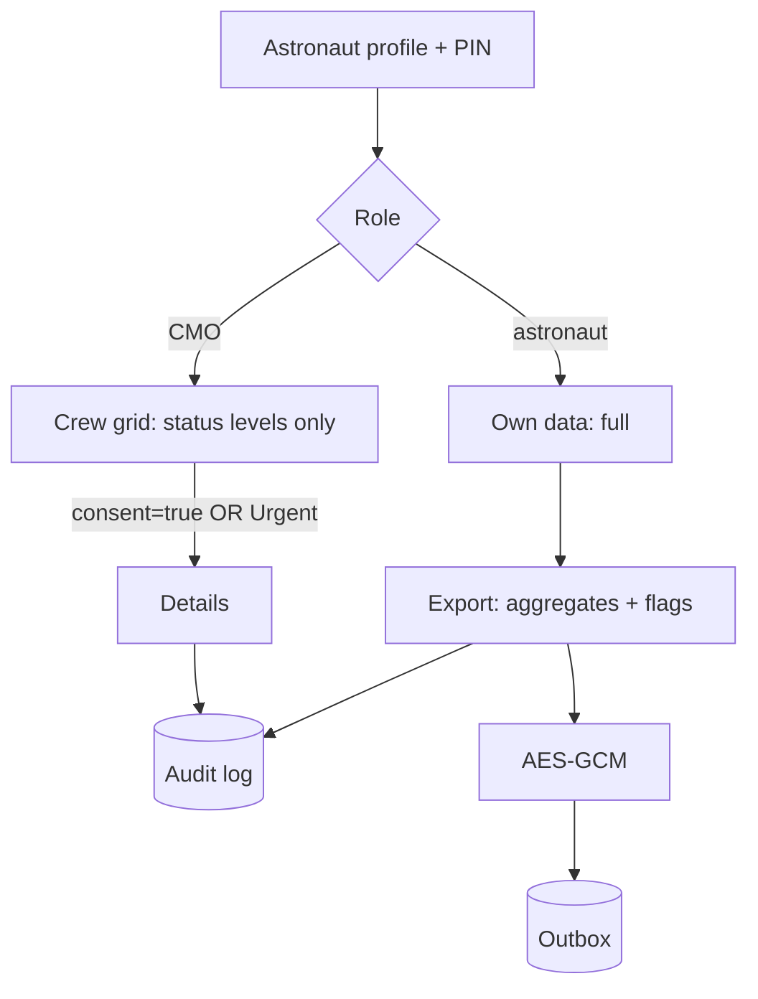
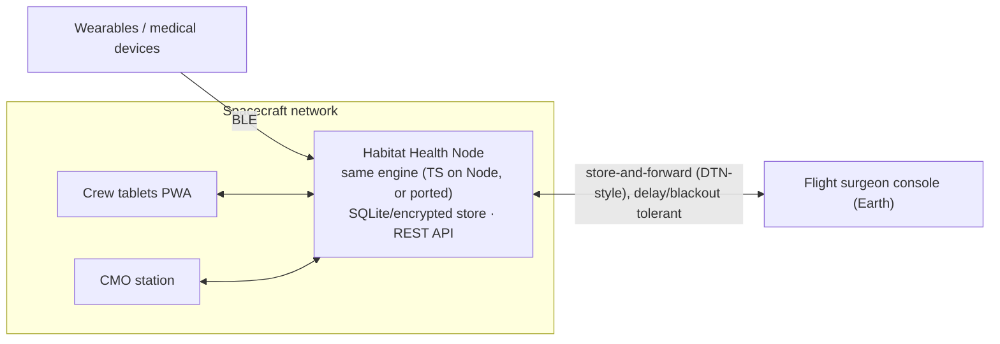

# Architecture: VITALS-M

Two views: the **MVP architecture** (what we build in one day) and the **target architecture** (how it would run on a spacecraft). Both share the same pure analytics engine, which is what makes moving from one to the other realistic.

## 1. Design drivers (space-mission constraints)

| Constraint | Architectural response |
|---|---|
| Earth is minutes away by signal, with blackouts (A4) | Offline-first: all computation and storage on board; Earth sync is a store-and-forward queue |
| Limited compute and power | Lightweight statistics (O(n) per metric); no ML inference; static app bundle |
| Crew autonomy | Engine runs locally; guidance needs no ground confirmation |
| Safety-critical messaging | Deterministic, pure engine; rules are traceable; red-flag override |
| Privacy in a small, confined crew | Data owned per astronaut; consent-gated views; aggregate-only exports |
| Reliability | No runtime dependencies on a network or third parties; data survives reloads (IndexedDB) |

## 2. MVP architecture (single offline PWA)

### Components

| Component | Responsibility | Interface |
|---|---|---|
| `ingest` | Validate and normalise imported wearable/manual data into `Observation`s; give each a `source` and `quality` | `ingest(raw): Observation[]` |
| `engine/baseline` | Rolling 21-day median and MAD per metric; Calibrating if < 7 valid days; excludes days flagged Act (stops "normalising" a drift) | `baseline(series, day): Baseline` |
| `engine/detect` | Robust z-score → EWMA and CUSUM per metric, direction-aware | `detect(series, baselines): MetricSignal[]` |
| `engine/rules` | Compound patterns, red-flag symptoms, limits set by the flight surgeon | `applyRules(signals, checkin, limits): Alert[]` |
| `engine/status` | Combine metric signals and alerts into domain and overall status levels | `status(alerts): StatusSummary` |
| `engine/explain` | Template text + evidence payload + next steps for each alert | `explain(alert): Evidence` |
| `store` | Dexie tables, typed queries | `db.*` |
| `comms` | Link state machine, outbox, simulated delivery delay | `enqueue(packet)`, `setLink(state)` |
| `ui/*` | Views (see `design.md`) | React components |

The engine has **no imports from React, Dexie or the browser**. Its input is plain data and its output is plain data, so it's unit-testable and could run unchanged on an onboard server.

## 3. Data flow

## 4. Engine detail

For each metric *m* with concerning direction(s) `dir ∈ {up, down, both}`:

1. `median`, `MAD` over the last 21 valid days before *d*, not counting days flagged Act. σ = max(1.4826·MAD, floorₘ). The floor stops division by roughly zero for very stable metrics.
2. z = (xₐ − median)/σ, sign-adjusted so that positive means "concerning direction".
3. EWMA: Eₐ = 0.2·z + 0.8·Eₐ₋₁. **Watch** if Eₐ ≥ 1.5, or z ≥ 2 on 3 consecutive days.
4. CUSUM: Sₐ = max(0, Sₐ₋₁ + z − 0.5). **Act** if Sₐ ≥ 4. Reset after acknowledgement plus 3 normal days.
5. Compound rule (e.g. illness-like pattern: resting HR, HRV and temperature all at Watch or above for ≥ 2 days) → domain **Act**.
6. **Urgent** if: red-flag symptom reported, or a value crosses a limit configured by the flight surgeon. Demo limits are labelled "DEMO – not clinical".
7. Overall status = the worst domain status; Calibrating domains are shown separately and never shown as "Normal".

All parameters live in `engine/config.ts` and are design hypotheses (A5), tuned on scenario S4.

## 5. Offline-first and synchronisation

- First load caches the app shell and demo data (Workbox precache). After that, no network is needed.
- All writes go to IndexedDB first. The outbox is a table of encrypted packets with status `queued | sending | delivered`.
- Comms simulator: `Online` (delivers after 2 s, as a stand-in for the real delay), `Delayed` (configurable: e.g. 20 s of demo time representing ~20 minutes), `Blackout` (holds everything). The UI shows "Autonomous mode" during Blackout.
- Conflict policy (target): the onboard copy is the source of truth; Earth only sends *messages* (new limits, notes), which are applied as new versioned records. Nothing is ever overwritten.

## 6. Security and privacy architecture

- Threats considered: a curious crewmate (consent + audit), a lost or stolen device (PIN; target: device encryption), interception of the Earth link (AES-GCM; target: agency-managed keys), over-sharing (aggregate-only export).
- Out of scope for the MVP: strong authentication, key management, encryption at rest (see `requirements.md` §7).

## 7. Target architecture (post-hackathon)

Changes from the MVP: a shared onboard store (sync across devices), real device ingestion, agency key management, DTN-style bundle transport (a delay-tolerant networking approach) for the Earth link. The engine and UI stay the same.
