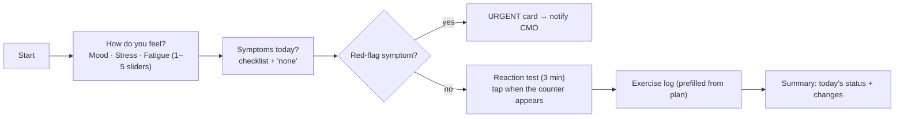
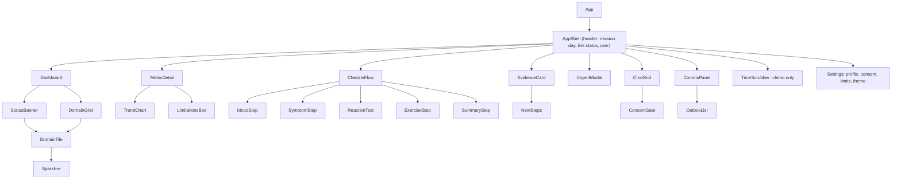

# Design: VITALS-M

Principles: **calm by default, loud only when it matters; one glance gives the status; every number says where it came from.** Designed for a tired, stressed user on a tablet, possibly floating, possibly wearing gloves.

## 1. Visual language

| Status | Icon | Word | Colour token | Meaning (exact on-screen wording) |
|---|---|---|---|---|
| Calibrating | ◌ | CALIBRATING | neutral grey | "Learning your usual range (n/7 days)" |
| Normal | ● | WITHIN RANGE | teal | "Within your usual range" (never "healthy") |
| Watch | ▲ | WATCH | amber | "Drifting from your usual range – keep an eye on it" |
| Act | ◆ | ACT | orange | "Sustained change – take the suggested steps" |
| Urgent | ■ | URGENT | red, full-screen | "Contact your CMO now" |

- Severity always uses **icon + word + colour** (works for colour-blind users).
- Source badges on every value: `MEAS` (wearable), `SELF` (self-report), `DERIV` (computed), `LAB` (equipment/lab, log only).
- Data-quality dot: solid = good, hollow = partial night or few beats, dashed = missing.
- Large type (base 18 px); touch targets ≥ 44 px (≥ 56 px on check-in); dark mode default (cabin night); light mode available.

## 2. Astronaut dashboard (wireframe)

```
┌────────────────────────────────────────────────────────────────┐
│ VITALS-M   Mission day 142   ◉ AUTONOMOUS MODE (Earth link down)│
│ Alex Reyes                                       [Check-in ▶]   │
├────────────────────────────────────────────────────────────────┤
│  ▲ WATCH   "Sleep has been shorter than your usual for 4 nights,│
│            and reaction time is slower."        [Why? ▶]        │
├───────────────┬───────────────┬───────────────┬────────────────┤
│ SLEEP      ▲  │ HEART      ●  │ MIND       ▲  │ ACTIVITY    ●  │
│ 5.4 h  MEAS   │ RHR 58  MEAS  │ Mood 3/5 SELF │ Ex 540/600 min │
│ ▁▂▂▁▁ band    │ ▂▂▂▂▂ band    │ RT 312ms DERIV│ ▃▃▂▃▃          │
├───────────────┼───────────────┼───────────────┼────────────────┤
│ SYMPTOMS   ●  │ BODY MASS  ●  │ RADIATION     │ LAB / EXAMS    │
│ none today    │ −0.8% wk LAB  │ 212/— mSv LOG │ log only  ◌    │
└───────────────┴───────────────┴───────────────┴────────────────┘
│ Outbox: 3 packets queued (will send when link returns)          │
└────────────────────────────────────────────────────────────────┘
```

- The top banner shows the worst active status and a one-line template summary.
- Domains: Sleep, Heart (resting HR, HRV, temperature), Mind (mood, stress, fatigue, reaction time), Activity (exercise vs plan, steps), Symptoms, Body mass, Radiation (log), Lab/Exams (log only, never shows a status).
- Sparklines show the last 14 days against the shaded personal band.

## 3. Metric detail view

- Header: metric name, source badge, "what this is / why it matters in space" (one sentence, citing research.md).
- Chart: line of daily values; shaded band = median ± 2σ; markers on Watch/Act days; grey hatching for Calibrating and missing days; toggle 30 / 90 / all.
- Under the chart: "Your usual: 6.3 h (range 5.6–7.0). Last 7 days: 5.5 h." Data-quality summary: "2 nights incomplete."
- Limitations box (from research.md), e.g. "Wrist sleep estimates are approximate."

## 4. Daily check-in workflow



- One question per screen, big controls; "Skip" is always available (skips are recorded, not penalised).
- Symptom list (needs physician review): headache, dizziness on standing, vision change, congestion/cold-like, rash/skin, sore muscles/joints, GI upset, trouble sleeping, low mood.
- **Red flags (demo list, physician review needed):** chest pain or pressure, fainting, sudden vision loss, severe shortness of breath, thoughts of self-harm. These trigger Urgent, plus a support pathway text approved by the flight surgeon (placeholder).
- Reaction test: random 1–4 s interval [12]; reaction < 100 ms counts as a false start, ≥ 500 ms counts as a lapse; the first 3 sessions are marked as practice.
- Sliders are labelled "Personal check-in (not a clinical questionnaire)".

## 5. Alerts and notifications

- **Watch:** an inline banner and a tile badge. No pop-up.
- **Act:** banner plus a badge on the Check-in button; persists until acknowledged; asks "Share with CMO?" if consent is off.
- **Urgent:** a full-screen modal, cannot be dismissed without choosing "I've contacted the CMO" or "CMO is with me"; CMO grid flashes; logged.
- Alert fatigue controls: at most one new Act per domain per 24 h; acknowledged alerts stay quiet until they get worse.

## 6. Evidence card ("Why?")

```
◆ ACT – Heart & temperature pattern            Day 97 · since day 95
Resting HR   64 bpm   usual 55 (52–58)   ↑ 3 days   MEAS
HRV ln(RMSSD) 3.4     usual 3.9 (3.7–4.1) ↓ 3 days  DERIV
Skin temp    +0.6 °C  usual ±0.2          ↑ 2 days  MEAS
Rule: three cardio metrics outside your range for ≥ 2 days (CUSUM)
On Earth, this combination is often seen with illness, poor sleep or overtraining.
It is not a diagnosis.                       Data quality: good (3/3 nights)
Next steps:  ☐ Rest and fluids per your mission plan  ☐ Re-check tomorrow
             ☐ Tell your CMO (Crew Medical Checklist §[placeholder])
[Acknowledge]  [Add note]  [Share with CMO]
```

Text comes from **templates** in `engine/explain.ts`, filled in with values. The source of every claim in the template is listed in research.md.

## 7. Next-step ladder

| Level | Self-care (from the mission plan) | CMO | Flight surgeon |
|---|---|---|---|
| Watch | Keep watching; review sleep and exercise schedule | — | Included in the daily packet if consented |
| Act | Steps from the mission plan (placeholder references) | Suggested: share details | Flagged in the packet |
| Urgent | Stop current task | **Contacted now** (automatic) | Priority packet queued |

We **never** give dosing, medication or treatment instructions. All procedure references are placeholders to be filled by the medical team.

## 8. Historical trends and insights

- "Mission timeline" view: rows per domain, columns per week, coloured cells by worst status. Highlights the drift patterns (like those seen in Mars-500 [14]) that daily checks miss.
- Weekly summary (Should): template text, e.g. "This week vs your usual: sleep −0.7 h, exercise −12%, mood steady."
- Projection (Could): dashed line + 80% prediction band, labelled "Trend projection – not a forecast."

## 9. Data model (shared TypeScript contract → `src/types.ts`)

```ts
type Source = 'MEAS' | 'SELF' | 'DERIV' | 'LAB';
type Level = 'CALIBRATING' | 'NORMAL' | 'WATCH' | 'ACT' | 'URGENT';
type Domain = 'sleep' | 'heart' | 'mind' | 'activity' | 'symptoms' | 'body' | 'radiation' | 'lab';
type MetricId = 'sleep_h' | 'sleep_eff' | 'sleep_mid' | 'rhr' | 'ln_rmssd' | 'skin_temp_dev'
  | 'spo2' | 'bp_sys' | 'mood' | 'stress' | 'fatigue' | 'rt_mean' | 'rt_lapses'
  | 'exercise_min' | 'steps' | 'body_mass' | 'dose_cum';

interface CrewMember { id: string; name: string; role: 'astronaut' | 'cmo'; pinHash: string;
  exercisePlanMinPerWeek: number; consent: { shareDetailsWithCMO: boolean; shareSummaryWithEarth: boolean } }
interface Observation { crewId: string; day: number; metric: MetricId; value: number | null;
  source: Source; quality: 'good' | 'partial' | 'missing' }
interface CheckIn { crewId: string; day: number; mood?: number; stress?: number; fatigue?: number;
  symptoms: string[]; redFlags: string[]; note?: string }
interface Baseline { metric: MetricId; median: number; sigma: number; nDays: number; calibrating: boolean }
interface MetricSignal { metric: MetricId; day: number; z: number; ewma: number; cusum: number; level: Level }
interface Alert { id: string; crewId: string; day: number; domain: Domain; level: Level;
  rule: string; metrics: MetricId[]; acknowledged: boolean }
interface Evidence { alertId: string; summary: string; rows: { metric: MetricId; value: number;
  baseline: Baseline; trendDays: number; source: Source }[]; nextSteps: string[] }
interface Limit { metric: MetricId; op: '<' | '>'; value: number; setBy: string; demo: boolean }
interface Packet { id: string; createdDay: number; crewId: string; cipherText: string;
  status: 'queued' | 'sending' | 'delivered' }
interface AuditEntry { ts: number; actor: string; action: 'view_details' | 'export' | 'urgent_override'; target: string }
interface Mission { day0: string; crew: CrewMember[]; observations: Observation[];
  checkins: CheckIn[]; truth: { crewId: string; scenario: 'S1' | 'S2' | 'S3' | 'S4'; startDay: number; endDay: number }[] }
```

Dexie tables: `crew`, `observations [crewId+day+metric]`, `checkins [crewId+day]`, `alerts`, `limits`, `outbox`, `audit`, `settings`.

## 10. Frontend component hierarchy



## 11. Modules ("backend" = the in-app engine and services)

```
src/
  types.ts            shared contract (§9)
  engine/             pure, no browser APIs
    config.ts  baseline.ts  detect.ts  rules.ts  status.ts  explain.ts  index.ts (run())
  services/           browser-side
    db.ts (Dexie)  ingest.ts  comms.ts  crypto.ts  audit.ts
  ui/                 components (§10)
scripts/generate.ts   synthetic mission generator (seeded)
public/demo/mission.json
tests/                engine unit, scenario, wording lint, e2e
```

## 12. UX rules for stressful conditions

1. One decision per screen; primary action at the bottom right, always the same place.
2. No numbers without context ("58 bpm, usual 55").
3. Never animate except the Urgent state; no confetti, no gamification streaks (they could pressure crew to hide symptoms).
4. Wording is reviewed against a banned-word list: *diagnosis, disease, depression, infection, healthy, safe, all clear, bone loss* (in status text).
5. Every screen works one-handed and with the font size doubled.
